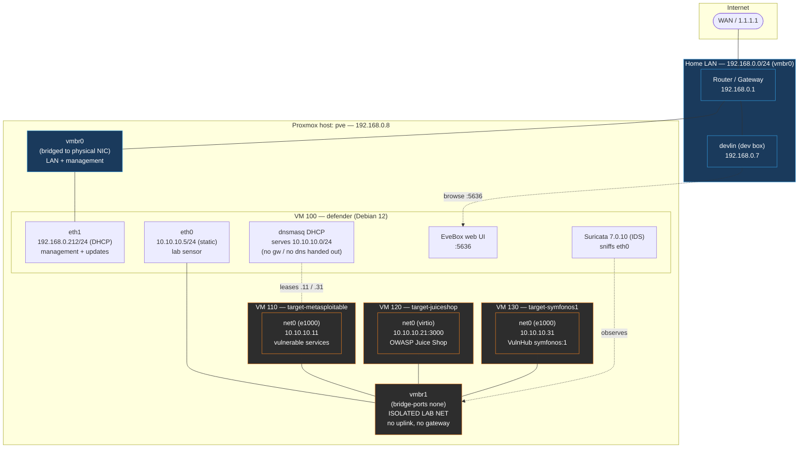

# Proxmox Security Lab — Architecture

> A self-contained, isolated security lab on the `pve` Proxmox host for learning
> blue-team detection (Suricata IDS) against a deliberately vulnerable target
> (Metasploitable 2). Built November 2026.
>
> **Companion doc:** [host-install-dual-boot.md](host-install-dual-boot.md) (how the
> `pve` host itself was installed as a Windows dual-boot).

---

## 1. Purpose

Learn how to **detect and defend against attacks** in a safe, throwaway environment,
so the skills transfer to protecting real production systems. The lab lets you:

- Run attack/recon traffic against a vulnerable target.
- Watch that traffic land in an IDS (Suricata) in real time via a web UI (EveBox).
- Practice the harden → re-test loop without any risk to the real `192.168.0.x` LAN.

The **containment boundary** is the single most important design element: the target
VM lives on an isolated virtual network with no route to the LAN or the internet.

---

## 2. Network topology



### Why it is contained

| Mechanism | Effect |
|---|---|
| `vmbr1` has `bridge-ports none` | The lab bridge has no physical NIC, so lab traffic physically cannot leave the host. |
| Lab subnet `10.10.10.0/24` ≠ LAN `192.168.0.0/24` | No address overlap, no accidental routing. |
| dnsmasq advertises **no gateway, no DNS** (`dhcp-option=3` / `=6` empty) | Leased hosts get an IP but have no route off-lab. |
| Only the **defender** has a second NIC on the LAN | The target has no LAN foot at all; only the defender is dual-homed (for updates + to serve the EveBox UI). |

---

## 3. Components

### Host — `pve` (192.168.0.8)
- Proxmox VE 9.2.2, kernel 7.0.2-6-pve.
- Storage: `local-lvm` (LVM-thin, ~2.6 TB free), `local` dir for ISOs/imports.
- Bridges: `vmbr0` (LAN/mgmt), `vmbr1` (isolated lab).
- Imported images staged in `/var/lib/vz/images-import/`.

### VM 100 — `defender` (Debian 12 "bookworm")
- 4 GB RAM / 2 cores / 40 GB disk. Built from the Debian genericcloud qcow2 + cloud-init.
- User `labadmin`, SSH-key auth (keys: `id_ed25519_toto`, `_toto_local`, `devlin`).
- NICs: `eth0` 10.10.10.5/24 (lab sensor), `eth1` 192.168.0.212/24 (DHCP, mgmt).
- Services:
  - **Suricata 7.0.10** — IDS sniffing `eth0`, HOME_NET `10.10.10.0/24`,
    ET Open ruleset (~53k rules), logs to `/var/log/suricata/eve.json`.
  - **EveBox 0.31.0** — web UI on `:5636`, sqlite backend, tails eve.json.
  - **dnsmasq** — DHCP for the lab net, bound to `eth0` only, hands out
    `10.10.10.100-199` + a static lease pinning the target to `.11`.

### VM 110 — `target-metasploitable` (Metasploitable 2)
- 1 GB RAM / 1 core / 8 GB disk. Imported VMDK, attached as **IDE** (`ide0`)
  — the 2012-era kernel cannot boot from virtio-scsi (it dropped to initramfs
  until switched to IDE).
- Single NIC `net0` (e1000) on `vmbr1`, address `10.10.10.11` (static DHCP
  lease by MAC).
- Deliberately vulnerable: vsftpd 2.3.4 backdoor, UnrealIRCd, old Samba, bindshell
  on 1524, DVWA/Mutillidae web apps (bundled on this same box, at `/dvwa/`
  and `/mutillidae/`), phpMyAdmin, TWiki, WebDAV. Default creds
  `msfadmin`/`msfadmin`.
- **Never** place this VM on `vmbr0`.

### VM 120 — `target-juiceshop` (OWASP Juice Shop)
- 2 GB RAM / 2 cores / 16 GB disk. Debian 12 cloud VM running the official
  `bkimminich/juice-shop` Docker image.
- Single NIC on `vmbr1`, static IP `10.10.10.21` (cloud-init, no gateway),
  app on `:3000`.
- Modern web-app attack surface (Node.js, API abuse, JWT issues, NoSQL
  injection, business-logic flaws) — deliberately different from
  Metasploitable's 2012-era service backdoors.
- Provisioned by **temporarily** adding a second NIC on `vmbr0` (DHCP) to
  install Docker and pull the image, then removing that NIC — the lab subnet
  itself never gets a route out. See `scripts/22-create-vm-target-juiceshop.sh`
  for the exact steps.

### VM 130 — `target-symfonos1` (VulnHub "symfonos: 1")
- 1 GB RAM / 1 core / 20 GB disk. Imported OVF/VMDK from VulnHub, boots fine
  from virtio-scsi (newer `vmx-15` hardware version, unlike Metasploitable).
- Single NIC `net0` (e1000) on `vmbr1`, address `10.10.10.31` (static DHCP
  lease by MAC).
- Beginner-level boot2root: SMB/web enumeration and a realistic privesc
  chain, rather than Metasploitable's pre-planted backdoors — good variety
  for practicing methodology instead of known exploits.
- **Never** place this VM on `vmbr0`.

### Other VMs on `pve`
VM 140 (`redteam`) exists on the host but is **outside this project's scope**
— created and owned directly by the lab operator, not by these scripts or
this documentation. It is dual-homed (lab net + LAN, with a firewall on the
LAN leg). Nothing in this repo manages, provisions, or depends on it.

---

## 4. Addressing & access reference

| Thing | Value |
|---|---|
| Proxmox web UI | https://192.168.0.8:8006 |
| Proxmox SSH | `ssh root@192.168.0.8` (key auth; run `sshagent` first) |
| Defender SSH | `ssh labadmin@192.168.0.212` |
| **EveBox UI (Suricata alerts)** | **http://192.168.0.212:5636** |
| Lab subnet | 10.10.10.0/24 (isolated) |
| Defender lab IP | 10.10.10.5 |
| Metasploitable lab IP | 10.10.10.11 |
| Juice Shop lab IP | 10.10.10.21 (app on :3000) |
| symfonos:1 lab IP | 10.10.10.31 |
| DHCP range (lab, dynamic pool) | 10.10.10.100 – .199 |

> Note: the host ended up on `192.168.0.8` (changed from the install-time `.77`).
> The defender's LAN IP `192.168.0.212` is now a **router-side DHCP reservation**
> pinned to MAC `BC:24:11:7B:A6:AB` (done 2026-11-18), so it won't drift on lease
> renewal. If EveBox ever becomes unreachable, re-check with
> `nmap -sn 192.168.0.0/24` and match that MAC.

---

## 5. How to use the detection loop

1. Open EveBox: http://192.168.0.212:5636
2. Generate traffic from the defender against the target, e.g.
   `ssh labadmin@192.168.0.212` then `sudo nmap -sS -sV 10.10.10.11`.
3. In EveBox:
   - **Inbox / Alerts** — signature hits (exploits, protocol anomalies).
   - **Events** — *all* records; filter `event_type:flow`, `http`, `smb`, `dns`.
4. Key lesson: a plain port scan is **observed** (flows/protocol logs) but rarely
   **alerted** on by ET Open — signatures fire on exploit payloads, not recon.
   **Fixed**: `scripts/suricata/local.rules` adds custom scan/recon signatures
   (SYN/NULL/FIN/Xmas/ACK scan, UDP sweep, Nmap NSE UA, slow-scan threshold) —
   Suricata has no built-in portscan preprocessor (unlike Snort's
   `sfPortscan`), so this is the standard community approach. An nmap scan now
   produces dozens of alerts instead of one.
5. Exploit traffic has been run against Metasploitable (vsftpd 2.3.4 backdoor —
   confirmed root shell). Suricata caught it via a **response-pattern**
   signature (`GPL ATTACK_RESPONSE id check returned root`), not a
   backdoor-specific one — a good illustration of detecting the *symptom*
   (root shell handing back command output) rather than the *trigger*. The
   UnrealIRCd backdoor (port 6667, CVE-2010-2075) did not reproduce reliably
   in testing and is parked for a later session — possibly worth retrying
   with Metasploit itself rather than hand-rolled sockets.

### Viewing the target's web apps from your laptop
The target is isolated, so you cannot browse `10.10.10.11` directly. Route through
the dual-homed defender with an SSH SOCKS proxy:
```bash
ssh -D 1080 labadmin@192.168.0.212          # start SOCKS proxy on your machine
# then set browser SOCKS5 proxy to 127.0.0.1:1080 and visit http://10.10.10.11/
```

In another terminal:
```bash
"C:\Program Files\Google\Chrome\Application\chrome.exe" --user-data-dir="%USERPROFILE%\chrome-socks" --proxy-server="socks5://127.0.0.1:1080" --host-resolver-rules="MAP * ~NOTFOUND , EXCLUDE 127.0.0.1"
```
in chrome:
```bash
http://10.10.10.11/
```
(and you arrive on Metasploitable home page)

---

## 6. Reproducing this environment

The build steps above were originally done by hand. They are now captured as
scripts in `../scripts/` (bridge creation, VM creation per host, defender
provisioning). See `../scripts/README.md` for run order and conventions.
Config files that used to exist only on the VMs (dnsmasq's `lab.conf`,
Suricata's `local.rules`) are now also version-controlled there.

## 7. Common operations

```bash
# --- on the Proxmox host (ssh root@192.168.0.8) ---
qm list                       # list VMs
qm start 110 / qm stop 110    # control the target
qm start 100 / qm stop 100    # control the defender

# --- on the defender (ssh labadmin@192.168.0.212) ---
sudo systemctl status suricata evebox dnsmasq
sudo suricata-update          # refresh rules
sudo systemctl restart suricata
sudo tail -f /var/log/suricata/eve.json | jq 'select(.event_type=="alert")'
sudo cat /var/lib/misc/dnsmasq.leases   # see lab DHCP leases
```

---

## 8. State & roadmap

**Done:** isolated `vmbr1`; defender (Suricata + EveBox + dnsmasq); Metasploitable,
Juice Shop, and symfonos:1 targets; scan/recon detection tuning (`local.rules`);
exploit traffic verified against Metasploitable (vsftpd backdoor); the lab is now
scripted/reproducible (`../scripts/`).

**Deferred / next:**
- UnrealIRCd backdoor exploitation (didn't reproduce reliably, parked).
- Samba usermap_script exploit, and a wrap-up EveBox review of what did/didn't alert.
- Windows/AD target (bigger attack-surface gap than another Linux box).
- Optional: GeoIP db for EveBox (cosmetic for private IPs), Suricata as a
  boot-time service check.

## 9. Host maintenance log

| Date | Action | Notes |
|---|---|---|
| 2026-11-18 | Switched `pve` from enterprise to `pve-no-subscription` repo | `pve-enterprise.sources` and `ceph.sources` (unused) disabled via `Enabled: no`, not deleted. New `/etc/apt/sources.list.d/proxmox.sources` added. Backups in `/root/apt-sources-backup-20261118/` on the host. |
| 2026-11-18 | `apt dist-upgrade` | 213 packages upgraded incl. kernel `7.0.2-6` → `7.0.14-29-pve` (not yet booted) and `pve-manager` 9.2.2 → 9.2.28. Clean, no broken packages. |
| 2026-11-18 | Baseline snapshots `baseline-20261118` | Taken on VMs 100 (defender), 110 (Metasploitable — **not pristine**, vsftpd backdoor already exercised), 120 (Juice Shop), 130 (symfonos:1). VM 140 intentionally excluded (out of scope). |
| 2026-11-18 | Defender LAN IP pinned | Router-side DHCP reservation for MAC `BC:24:11:7B:A6:AB` → `192.168.0.212` stays stable on lease renewal. |
| 2026-11-18 | Host rebooted onto new kernel | `pveversion` confirms `running kernel: 7.0.14-29-pve`. VMs 100/110/120/130 don't auto-start (no `onboot`), so they were started manually afterward; all came back healthy (Suricata/EveBox/dnsmasq active, all 3 targets reachable). VM 140 has `onboot: 1` and came back on its own. |

